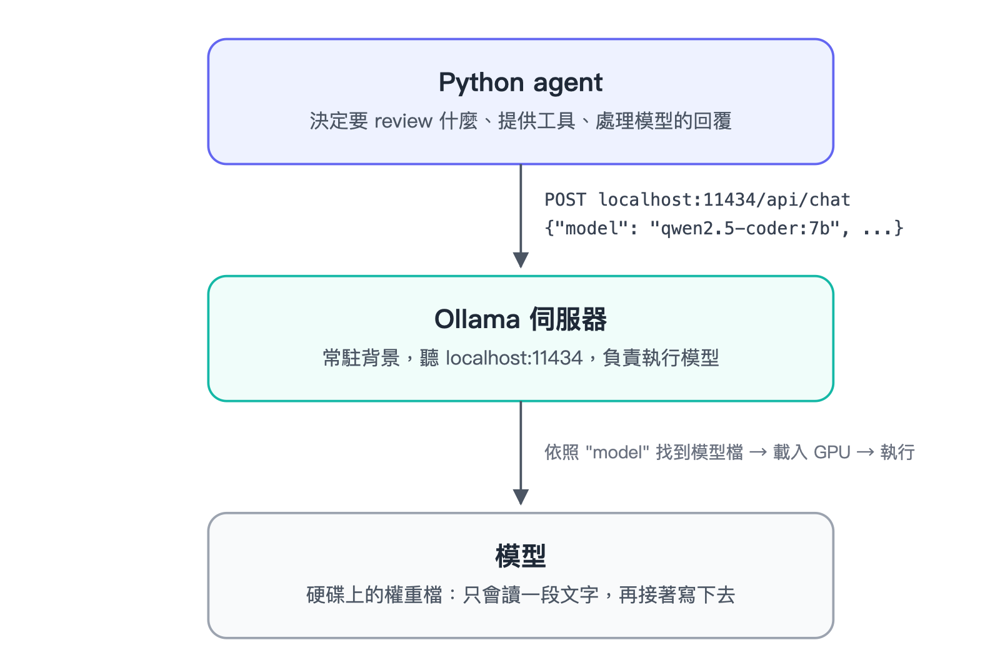
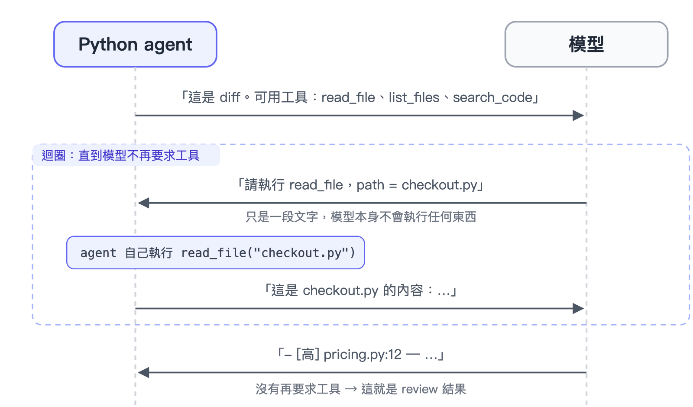
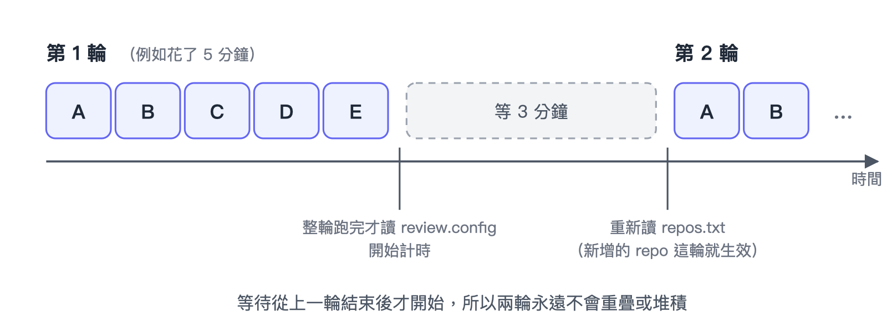
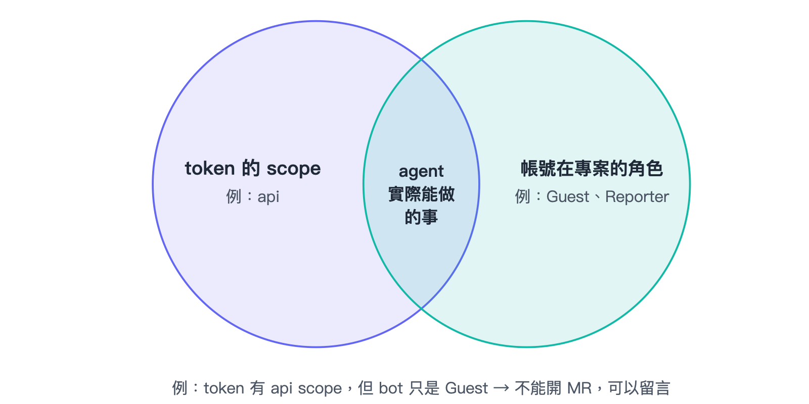

# 用本機模型打造免費的 AI Code Review Agent：從 Ollama 到自動 review GitLab MR

想讓 AI 幫你 review Merge Request（MR），常見的做法是打開平台內建的 AI 功能，或是把程式碼送給雲端模型。但如果你的程式碼不能離開自己的電腦，或是不想每次 review 都付費，還有另一條路：**在自己的電腦上跑開源模型，再寫一個 Python agent 監看 MR、自動 review。**

這篇文章會一步一步把這個 agent 做出來。完成後，它可以：

- 監看多個 GitLab 專案，review 每一個新的 MR，以及之後推上去的每一個新 commit
- 考慮整個專案，而不只是 diff。例如某個函式的參數改了，另一個檔案的呼叫端卻還在用舊的參數，它也抓得到
- 用另一個 bot 帳號，把每次 review 以 thread 的形式貼到 MR 上
- 完全在本機執行：不用雲端 AI 服務、沒有使用費，而且只用 Python 標準函式庫

我也會分享它在一個「埋了 7 個 bug 的測試 MR」上實際抓到了什麼、哪些問題出在模型、哪些出在我自己的程式，以及後來補上的防護機制。

完整的程式碼都在 GitLab：[gitlab.com/machinelearning7311303/CodeReviewPythonAgent](https://gitlab.com/machinelearning7311303/CodeReviewPythonAgent)

## 快速開始

```bash
git clone https://gitlab.com/machinelearning7311303/CodeReviewPythonAgent.git
cd CodeReviewPythonAgent
ollama pull qwen2.5-coder:7b
# repos.txt：要監看的 GitLab repo，一行一個網址（HTTPS 或 SSH 都可以）
# review.config：每輪之間等幾分鐘，1 到 10
# bot_account.config：bot 帳號的 GitLab token，需要 api 權限（已加進 .gitignore）
python -m review_agent          # 持續監看
python -m review_agent --once   # 只跑一輪就結束
python -m unittest discover -s tests -t .
./stop_agent.sh                 # 停掉正在跑的 agent（Windows：.\stop_agent.ps1）
```

macOS 上請用 `python3`，版本要 3.11 以上（因為用到 `tomllib`）。

Review 報告會寫在 `workdir/reports/`。選填的進階設定（模型、context 大小、目標分支、檔案過濾）放在 `config.toml`，格式可以參考 `config.example.toml`。

---

## PART 1：安裝 Ollama，挑一個適合 code review 的模型

### 模型、Ollama、agent 各是什麼

動手安裝之前，先把三個常被混在一起的東西分清楚：

- **模型**是一個裝著幾十億個數字（權重）的檔案。它不會自己執行，也沒有 API，能做的只有「讀一段文字，然後接著寫下去」。
- **Ollama** 是負責執行模型的伺服器。它常駐在背景，聽 `http://localhost:11434`。收到請求時，它會找到請求裡指定的模型，載入 GPU、執行，再把結果傳回來。
- **Agent** 是我們要寫的 Python 程式。它決定要 review 什麼、讓模型能用哪些工具，以及怎麼處理模型的回覆。

三者的關係如下：



每次請求要用哪個模型，是 agent 在 `model` 欄位裡指定的。Ollama 只是照名字找到模型、把它跑起來。

### 安裝 Ollama

Windows 用 winget 一行就能裝好：

```powershell
winget install --id Ollama.Ollama --exact
```

也可以到 [ollama.com/download](https://ollama.com/download) 下載安裝檔，macOS 和 Linux 都有。

裝好之後 Ollama 會在背景啟動。確認伺服器有在跑：

```bash
curl http://localhost:11434/api/version
```

看到類似 `{"version":"0.40.13"}` 的回應就代表成功了。

> **那個登入視窗可以不理它。** 裝完後可能會跳出視窗，要你登入或連結 ollama.com 帳號。那只有用 Ollama 的雲端模型時才需要；在本機跑模型不用帳號，直接關掉就好。

### 模型存在哪裡

Windows 的預設位置：

- Ollama 本身：`C:\Users\<你的帳號>\AppData\Local\Programs\Ollama`
- 下載的模型：`C:\Users\<你的帳號>\.ollama\models`

一個模型從幾 GB 到幾十 GB 都有。如果 C 槽空間不夠，請在**下載任何模型之前**設定這個環境變數，把模型放到其他磁碟，然後重新啟動 Ollama：

```powershell
setx OLLAMA_MODELS "D:\OllamaModels"
```

### 挑模型之前，先看你的硬體

本機能跑多大的模型，幾乎完全取決於顯示卡的記憶體（VRAM）。NVIDIA 顯示卡可以這樣查：

```powershell
nvidia-smi --query-gpu=name,memory.total,memory.used --format=csv
```

注意 `memory.used`。其他程式也會吃 VRAM，所以真正留給模型的是「總量減掉已經在用的」。

如果模型塞不進 VRAM，Ollama 會把一部分搬到系統記憶體、改用 CPU 執行，速度會慢很多。

### 怎麼挑 code review 用的模型

要當 review agent 的大腦，模型需要具備三個條件：

1. **支援 tool calling。** Agent 必須讓模型能提出「讀這個檔案」、「搜尋這個函式」之類的請求。到 [ollama.com/search](https://ollama.com/search?c=tools) 用 *Tools* 標籤篩選，就能找到支援的模型。
2. **針對程式碼訓練。** 名字裡有 *coder* 或 *code* 的模型，通常比同樣大小的通用模型更懂程式碼。
3. **大小塞得進你的 VRAM。** Ollama 預設下載 4-bit 量化版，大約佔「參數量（以十億為單位）× 0.6 GB」，執行時還要再加上 context 需要的記憶體。

在我的電腦上（RTX 5060 8 GB VRAM、32 GB RAM），我比較了這幾個候選：

**✅ qwen2.5-coder:7b（我最後選的）**

- 下載 4.7 GB，context 最大 32K
- 阿里巴巴 Qwen 團隊的開源程式碼模型，也是 8 GB 顯示卡最常被推薦的選擇
- 可以整個放進 GPU，所以很快

**qwen3-coder:30b**

- 下載 19 GB，context 最大 256K
- Mixture-of-Experts 架構，總共 30B 參數，但每次只啟用 3.3B。它是為 coding agent 設計的，效果明顯比較好
- 8 GB VRAM 放不下，大部分會跑在 CPU 和系統記憶體上。還是能用，但很吃 RAM

**rnj-1:8b**

- 下載 5.1 GB，context 32K
- 比較新的模型，官方 benchmark 很亮眼，tool calling 也強，但目前社群的實際使用經驗還比較少

> **VRAM 比較多嗎？** 如果有 24 GB 以上，直接選 `qwen3-coder:30b` 這類大模型。它的 review 推理深度好很多，PART 6 會說明為什麼這很重要。

### 認識 qwen2.5-coder

`qwen2.5-coder:7b` 這個名字可以拆成四個部分：

- **Qwen**：阿里雲的大型語言模型系列
- **2.5**：第 2.5 代
- **Coder**：程式碼特化版，是拿通用的 Qwen2.5 再用大量程式碼繼續訓練出來的
- **7b**：70 億個參數

它是開放權重的模型，大部分尺寸採用 Apache 2.0 授權。下載之後不用連網就能跑，也完全免費。

### 下載並測試模型

```bash
ollama pull qwen2.5-coder:7b
```

下載下來的其實是好幾個檔案：一個 4.4 GB 的權重檔、一份 chat template、一段預設的 system prompt，以及授權條款。**Chat template** 負責把對話和工具清單轉成模型真正讀到的純文字，PART 2 會再提到它。

接著直接跟模型對話，確認它能正常運作：

```bash
ollama run qwen2.5-coder:7b "用一句話解釋 race condition"
```

另開一個終端機執行 `ollama ps`，可以看到模型載入的狀況：

```
NAME                SIZE      PROCESSOR    CONTEXT
qwen2.5-coder:7b    5.5 GB    100% GPU     16384
```

要看的是 `PROCESSOR` 這一欄。**`100% GPU` 代表整個模型都在顯示卡上**，這是最快的狀態。如果看到 `40%/60% CPU/GPU` 這種拆分，代表有一部分在 CPU 上跑，可以換小一點的模型，或把 context 調小。

還有兩件事要知道：

- **第一次呼叫很慢。** 我的第一個請求花了大約 55 秒，大部分時間都在把模型載入 VRAM。之後同樣的請求只要幾秒。
- **閒置的模型會被卸載。** Ollama 預設在模型閒置 5 分鐘後把它移出 VRAM，下一次呼叫就要重新載入。

### 用 API 測試

Agent 是透過 HTTP API 跟 Ollama 溝通的，所以最後用 API 測一次（以 PowerShell 為例）：

```powershell
$body = @{
  model = "qwen2.5-coder:7b"
  messages = @(@{ role = "user"; content = "這段 Python 有什麼問題？def avg(xs): return sum(xs) / len(xs)" })
  stream = $false
} | ConvertTo-Json -Depth 5

(Invoke-RestMethod -Uri http://localhost:11434/api/chat -Method Post -Body $body -ContentType "application/json").message.content
```

macOS 或 Linux 可以用 curl：

```bash
curl -s http://localhost:11434/api/chat -d '{
  "model": "qwen2.5-coder:7b",
  "messages": [{"role": "user", "content": "這段 Python 有什麼問題？def avg(xs): return sum(xs) / len(xs)"}],
  "stream": false
}'
```

模型應該會指出：傳入空的 list 時會除以零。

---

## PART 2：Agent 迴圈——讓模型自己要求使用工具

Agent 不是模型。它是一個「用迴圈呼叫模型、並提供**工具**給模型」的程式。模型本身不會執行任何東西，它只能回覆一段像「請幫我對 `checkout.py` 執行 `read_file`」這樣的請求，要不要真的執行，由 Python 程式決定。



Agent 提供三個工具，全部唯讀，而且都固定在 MR 版本的程式碼上：

- `read_file(path, start_line, end_line)`：讀取檔案內容（附行號）
- `list_files(directory)`：列出資料夾底下的檔案
- `search_code(text)`：用 `git grep` 找出包含某段文字的行

「唯讀」就是安全邊界。不管模型要求什麼，它都改不了專案。

迴圈的核心很短。工具以 JSON schema 的形式放在請求的 `tools` 欄位，每個工具的執行結果再以 role 為 `tool` 的訊息傳回去：

```python
for _ in range(max_tool_steps):
    reply = llm.chat(messages, tools=TOOL_SCHEMAS)
    messages.append(reply)
    calls = reply.get("tool_calls") or tool_calls_in_text(reply.get("content", ""))
    if not calls:
        return reply["content"]          # 沒有再要求工具：這就是 review 結果
    for call in calls:
        name = call["function"]["name"]
        result = tools.call(name, call["function"]["arguments"])
        messages.append({"role": "tool", "tool_name": name, "content": result})
```

> **踩坑：qwen2.5-coder 會把 tool call 寫成純文字。** 照理說 Ollama 應該把工具請求放在回覆的 `tool_calls` 欄位。但我第一次用 qwen2.5-coder 測試時，`tool_calls` 是空的，文字內容反而是：
>
> `{"name": "read_file", "arguments": {"path": "src/pricing.py"}}`
>
> 模型只會照它的 chat template 教它的格式寫文字，而 Ollama 沒有把這種格式認成 tool call。如果不處理，agent 就會把這段 JSON 當成 review 貼出去。解法就是上面那個 `tool_calls_in_text` 備援：如果整段回覆就是一個「已知工具」的 tool call JSON，就把它當成 tool call 處理。

跟 Ollama 溝通也不需要任何套件。Agent 直接用 `urllib` 發 HTTP POST，所以整個專案只用到標準函式庫。

---

## PART 3：Review MR 時把整個專案考慮進去

只看 diff 會漏掉最重要的那種 bug：改動本身沒問題，卻把別的地方弄壞了。但模型的 context 放不下整個專案。`num_ctx` 設成 16,384 個 token 時，大約只能放 30,000 個字元的輸入。所以 agent 會替每個改動挑出專案裡相關的部分。

首先要拿到 MR 實際的改動。GitLab 會把每個 MR 都公開成一個 ref，就算 MR 來自 fork 也適用：

```
git fetch origin +refs/merge-requests/12/head:refs/review/mr/12
git merge-base refs/remotes/origin/main refs/review/mr/12
git diff <merge-base> refs/review/mr/12
```

接著，針對每個改動的檔案，模型會收到：

1. **專案概要。** 由模型根據檔案樹、README 和建置檔寫一次，agent 會快取起來，直到這些檔案有變動為止。
2. **MR 本身的資訊**：標題、描述，以及它改了哪些檔案。
3. **這個檔案完整的新版本**，而不只是 diff。
4. **diff 裡呼叫到的東西的定義**：在專案裡搜尋 `def`、`fun`、`func`、`class`，以及 C 風格的 `type name(...)` 這類定義行。
5. **其他使用到這次改動內容的地方**，「改了函式簽名、呼叫端卻沒跟著改」就是靠這個抓到的。

讓我確信這套做法有效的是這個測試：有一個測試 MR 把 `apply_discount(price, rate)` 從「傳 0.1 代表打九折」改成「傳 10」，但另一個檔案的呼叫端還在傳 0.1。只看 `pricing.py` 的 diff 完全看不出問題。附上使用處之後，模型 3 秒就回答了：

```
- [中] pricing.py:1 — 函式簽名改了，但 checkout.py 裡的呼叫沒有跟著更新。
```

它找到了問題，但也顯示出模型的極限：這其實是高嚴重度的 bug（折扣從 10% 變成 0.1%），正確的修法是把 `0.1` 改成 `10`，而不是改參數名稱。

> **踩坑：C 和 C++ 的函式定義沒有關鍵字。** 我的第一版是靠搜尋 `def`、`fun`、`func` 來找定義，結果在 C++ 專案上什麼都找不到，模型一直說同一個 MR 裡的函式「看不到實作」。C 風格的定義長得就像 `int* copy_values(const std::vector<int>& values) {`，所以 agent 現在也會比對 `type name(` 這種行，略過 `return name(` 這類呼叫，並且優先選有函式本體的定義、而不是 header 裡的宣告。

---

## PART 4：持續監看多個 repo

Agent 會讀兩個純文字檔，而且每一輪都重新讀，所以新增 repo 或調整間隔都不用重啟。

`repos.txt` 一行放一個 repo，HTTPS 或 SSH 都可以：

```
# 要監看的 repo
https://gitlab.com/group/project
git@gitlab.com:group/another-project.git
```

`review.config` 只放一個 1 到 10 的數字：每輪之間要等幾分鐘。

等待是**在一輪跑完之後**才開始計時，不是照固定的時鐘。如果 review 五個 repo 花了五分鐘，下一輪就會在「五分鐘 + 間隔」之後才開始，所以不同輪之間永遠不會重疊或堆積：



每個 repo 都有自己的 clone、狀態檔和報告。其中一個 repo 出問題（沒有權限、網路斷線）時，只會記錄下來、跳過它，其他 repo 照樣 review。

---

## PART 5：用 bot 帳號把 review 貼成 GitLab thread

### 帳號

即使是公開專案，**GitLab 也不允許匿名留言**，所以 agent 需要一個帳號和 token。讀取 MR 和 clone 公開專案則兩者都不需要。

GitLab 的 project access token 會附帶一個專屬的 bot 使用者，但需要 Premium 方案。在 GitLab Free 上，替代做法是**幫 bot 另外註冊一個免費帳號**，再替它建立 personal access token。

Token 只給 `api` 這個 scope（留言需要的就是它），並設定到期日。然後把帳號在專案裡的角色壓到最小。一個 API 呼叫能做什麼，是由 token 的 scope **和**帳號在專案裡的角色共同決定的：



在公開專案上，bot 完全不用是成員，任何已登入的帳號都能留言。私有專案給 Reporter 就夠了。不要給 Developer：萬一 token 外洩，Developer 的 token 是可以推程式碼的。

「角色」這一半是我意外學到的。我曾經試著用 bot 的 token 開 MR，結果拿到 `403 Forbidden`，明明 token 有 `api` scope。原因是 bot 在那個專案裡只是 Guest，而開 MR 需要 Developer。至於留言，也就是 agent 唯一會做的事，Guest 就完全沒問題。

Agent 會從 `bot_account.config` 讀取 token；如果有設定環境變數 `GITLAB_TOKEN`，則以環境變數優先。**在做任何事之前，先把這個檔案加進 `.gitignore`**，確保它永遠不會被 commit 進去。

### 一次 review 一個 thread

Agent 用的是 GitLab 的 discussions API，也就是「Start thread」按鈕背後的那個功能。它建立的是可以 resolve 的 thread，而不是一般留言。模型找到的每一點會變成一個項目，最後一行則標記這次 review 的 commit：

```
AI code review（qwen2.5-coder:7b，commit 8d7f3bbc）

- [中] helloworld.cpp:11 — copy_values 回傳的指標從來沒有被釋放 ...
- [中] stats.cpp:22 — sprintf 可能會讓 char line[16] 溢位 ...

##agent reviewed 8d7f3bbcea58
```

最後那一行就是 agent 的記憶。Review 一個 MR 之前，它會先讀自己在那個 MR 上最新的留言：

- **跟 MR 最新的 commit 相同**：直接跳過，完全不呼叫模型。
- **不同的 commit，或是還沒有 thread**：刪掉 agent 自己的舊 thread，重新 review，再開一個新的 thread。

因為這份紀錄存在 GitLab 上，換一台新電腦、或是本機狀態檔被刪掉，都不會讓同一個 commit 被 review 第二次，而且一個 thread 永遠不會混到不同 commit 的結果。被刪掉的只有 bot 自己的留言，其他人在舊 thread 裡的回覆都會保留。

### 沒有問題時，自動 resolve thread

如果這次 review 一個問題都沒有，agent 一樣會開新的 thread，內容寫「沒有發現需要注意的地方。」，最後一行同樣標記 commit，然後**立刻把這個 thread 設成 resolved**。既然沒有需要討論的事，這個 thread 就不該當作「還沒解決的討論」卡住 merge。

要特別注意的是，判斷依據是程式裡「問題清單是空的」這個條件，而不是去比對留言文字。就算有人在 MR 上手打同一句話，agent 也不會去動那個 thread。另外，如果 resolve 這一步失敗，agent 只會記錄警告，不會把整次 review 當成失敗。因為 review 已經貼上去了，如果當成失敗，下一輪會看到最後一行的 commit 標記而跳過，那個 thread 就永遠不會被 resolve。

在我的測試 MR 上，實際流程長這樣：

- 推上沒有問題的 commit → 開新 thread、寫「沒有發現需要注意的地方」、自動 resolved
- 推上埋了 bug 的 commit → 刪掉剛才那個 resolved 的 thread、開新 thread 列出問題、維持 unresolved
- 把 bug 修好再推一次 → 刪掉有問題的 thread、開新 thread、自動 resolved

> **小提醒：** 即使是公開專案，GitLab 的 discussions API 也需要驗證；列出開著的 MR 則不需要。

---

## PART 6：它實際抓到了什麼，以及需要補上的防護

為了評估 agent，我在一個小型 C++ 專案上開了一個 MR，在看起來很普通的程式碼裡埋了 7 個 bug：

- 迴圈多跑一次、讀到陣列尾端之外
- 整數除法把小數部分吃掉
- 用 `int` 加總可能溢位
- `memcpy` 只複製了 `values.size()` 個 byte，而不是 `values.size() * sizeof(int)`
- `sprintf` 可能讓 `char line[16]` 溢位
- 呼叫端少了 `delete[]`
- `size_t` 被縮窄成 `int`

第一次 review 貼出了 13 點，只找到 7 個 bug 中的 2 個，外加半個；記憶體洩漏重複講了三次；還有一些講得很有自信的胡話，例如建議用 `long double`「提高精度」，或是叫呼叫端去 `#include` 一個早就 include 過的 header。

其中一部分是模型的極限，另一部分是我自己的程式寫得不好。以下是有幫助的修正，大致依照效果排序：

1. **丟掉引用其他檔案的項目。** Review 某個檔案時，模型也會看到相關的檔案，於是把那些檔案的 bug 也一起報出來，卻標在錯的檔案上。每個檔案自己的 review 本來就會涵蓋它自己的 bug。
2. **丟掉引用「改動範圍以外行號」的項目**，但保留幾行的寬容度。這擋掉了模型編出來的行號，例如一個只有 7 行的 header，它卻說第 25 行有問題。
3. **在 prompt 裡附上常見缺陷類型的檢查清單**：邊界、整數除法與溢位、大小計算（例如複製的 byte 數）、沒釋放的資源、空的輸入。加上之後，模型開始抓得到整數除法和緩衝區溢位。
4. **限制回答長度。** 有一次 review 跑了九分鐘以上，因為模型卡在不斷重複同一段話，直到 context 塞滿。把 `num_predict` 設成 1,536 個 token 就能擋住；當 Ollama 回報 `done_reason: "length"` 時，agent 會丟掉最後那行寫到一半的內容，不把它貼出去。
5. **提高 repeat penalty**，設成 1.15、作用範圍是最近 256 個 token。Ollama 預設的「1.1、最近 64 個 token」擋不住整句話重複出現三次。我只調高一點點，因為 review 會引用程式碼，而程式碼本來就會合理地重複出現同樣的名稱。

> **踩坑：不要讓小模型刪除 review 結果。** 我試過讓模型自己合併「換句話說」的重複項目，先是問它要保留哪幾點，後來改問哪些點是在講同一件事。兩種做法都往最糟的方向失敗：有一次它把所有提到陣列越界的項目全刪了，另一次它把整數除法的 bug 跟一個不相關的項目歸成一組，結果整數除法那條就被刪掉了。現在 agent 只會移除完全重複的項目（忽略行號和標點）。多一條重複的項目，讀者只要多花幾秒；少了一個真的 bug，代價就大得多。

修正之後，對同一個 MR 做 review，通常能找到陣列越界、整數除法、`sprintf` 溢位和記憶體洩漏，每次花 30 到 60 秒，但還是會夾帶一兩條錯誤的建議。我修好其中一個 bug 再推上去之後，agent 在一輪之內就換掉了它的 thread，修好的 bug 也不再出現。

後來我又做了一個小實驗：在同一個 MR 上再埋 4 個 bug。結果它抓到了編譯器不會警告的兩個（`<=` 越界，以及對空的 vector 讀 `values[0]`），卻漏掉了編譯器會警告的兩個（`if (score = 80)` 把比較寫成賦值，以及回傳區域陣列的指標）。這也表示，在 review 之前先跑一次編譯器警告、把結果交給模型參考，會是一個成本很低的改進方向。

誠實的結論是：**7B 模型適合當第一輪的初步檢查，而不是可以盲目信任的 reviewer。** 它能注意到真的 bug，但推理很淺。它有標出那行有問題的 `memcpy`，理由卻是錯的；而且每次跑的結果也不太一樣。寫在程式裡的防護可以阻止它在錯的地方貼出胡話，但要讓推理更深入，只能靠更大的模型，例如 `qwen3-coder:30b`。

---

整個 agent 大約一千行，只用 Python 標準函式庫，附有 91 個單元測試。用 `python -m review_agent` 啟動，或加上 `--once` 只跑一輪。

原始碼：[gitlab.com/machinelearning7311303/CodeReviewPythonAgent](https://gitlab.com/machinelearning7311303/CodeReviewPythonAgent)。clone 下來之後，記得自己建立 `bot_account.config` 放 bot 的 token。repo 裡不會附這個檔案，它已經列在 `.gitignore` 裡。
